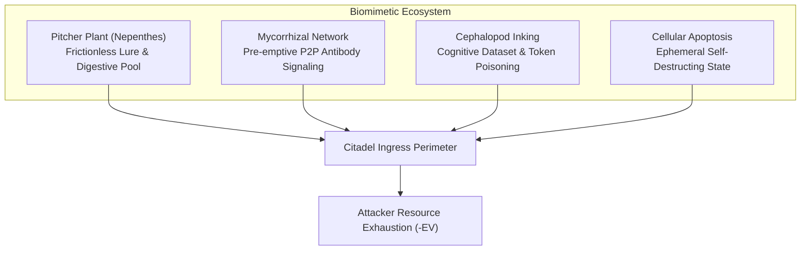

# Citadel: The Biomimetic Defense Paradigm & Counter-Economic Architecture

> *"A fortress that only absorbs blows is a dying shell. In an ocean of automated swarms, defense must become a living predator."*  
> — *Lineage: Edgerunner Violet & Mandala Kekkai (2025–2026)*

---

## Executive Abstract

Modern internet security suffers from a fatal economic asymmetry: **attackers operate at near-zero marginal cost, while defenders bear compounding operational, computational, and cognitive overhead.** Automated swarms scan the IPv4 and IPv6 address space, probe exposed endpoints, and deploy autonomous LLM agents to harvest credentials and compute.

**Citadel** overturns this paradigm by merging the lineage of **Edgerunner Violet** (high-frequency frontier security, red/blue purple-team symbiosis) with **biomimetic defense mechanisms** and **active counter-economics**. 

Instead of passive firewalls that return `403 Forbidden` or `Connection Refused`, Citadel transforms the target perimeter into a carnivorous ecosystem. Attackers are lured into deceptive digital twins, held in kernel-level tarpits, forced to expend expensive AI tokens navigating synthetic labyrinths, and made to pay computational and on-chain tolls that directly fund the defender's sovereign infrastructure.

---

## Part I: The Lineage — From Edgerunner Violet to Citadel Gen 3

### 1.1 The Violet Thesis
The name **Edgerunner Violet** (first formulated in September 2025 within the WhiteMagic architecture) represents two core concepts:
1. **The Edgerunner:** An autonomous agent operating at the technological frontier, navigating ambiguous and adversarial network environments.
2. **Violet:** The highest-frequency visible light at the edge of the optical spectrum. In the WhiteMagic security model, the Violet posture is the most aggressive, mathematically bounded layer.

### 1.2 The Failure of the Concrete Wall
Traditional cybersecurity relies on static, perimeter-based defenses:
- IP blacklists that are stale the moment they are written.
- Intrusion Detection Systems (IDS) drowning in false positives from ambient background noise.
- Single-point VPN concentrators that create high-value choke points.

When rogue swarms can rotate through hundreds of IPv4/IPv6 addresses per minute (as demonstrated by the 301-IP botnet captured by Citadel), static blocking is futile. The defender must move from **passive resistance** to **metabolic engagement**.

### 1.3 Purple-Team Symbiosis (The Dissolution of Red vs. Blue)
In nature, predator and prey co-evolve in a tight evolutionary spiral. Edgerunner Violet established that:
- **Defense without offensive telemetry is blind.** Defenders must understand the exact tools, HASSH ciphers, and prompt-injection vectors used by attackers.
- **Offense without defensive governance is reckless.** Offensive tooling must operate within mathematically provable Rules of Engagement (RoE) and cryptographic containment (Mandala Kekkai).
- **The Attacker as Unpaid Penetration Tester:** By ingesting live attack vectors directly into the purple-team corpus (`attacker_vectors.json`), every hostile probe actively hardens our regression suite (`violet_stress_test.py`).

---

## Part II: Biomimetic Defense Architectures

Nature has spent 3.8 billion years solving asymmetric warfare. Citadel translates four core biological mechanisms into digital architecture:



### 2.1 The Pitcher Plant (*Nepenthes*) — Multi-Stage Digestion
- **Biological Principle:** Carnivorous pitcher plants secrete sweet, fragrant nectar on a microscopic, wax-coated peristome. The insect encounters zero friction initially. As it ventures deeper, micro-grooves direct its footing downward into a pool of digestive enzymes. The plant extracts nitrogen and phosphorus from the insect's body to flourish in nutrient-depleted soil.
- **Citadel Implementation (The Venus Flytrap):**
  - **Frictionless Ingress:** Decoy ports and paths (`/.env`, `/v1/models`, Cowrie SSH) accept initial connections smoothly.
  - **The Two-Touch Invariant:** Single ambient pings (Shodan, masscan) are ignored to prevent false positives.
  - **Enzymatic Trap:** The moment a source touches **two distinct decoy classes** (e.g., SSH session + proxy pivot request, or `.env` scrape + LLM decoy query), an atomic `nft add element` traps the IP in the kernel tarpit in under 60 seconds.
  - **Nutrient Extraction:** Telemetry, client fingerprints (HASSH), and attack payloads are harvested to feed the defensive mesh.

### 2.2 The Mycorrhizal Network — Decentralized Interspecies Signaling
- **Biological Principle:** Underground fungal mycelium networks connect disparate tree species in old-growth forests. When pests attack one tree, chemical warning signals traverse the fungal hyphae, prompting trees kilometers away to pre-emptively produce defensive tannins before the pest arrives.
- **Citadel Implementation (The Cryptographic Defense Mesh):**
  - Every Citadel sensor node signs its threat intelligence with a dedicated Ed25519 feed key.
  - Drops-in community firewalls (`nftables-set.nft`) with 24-hour element timeouts are broadcast to peer nodes.
  - Participating nodes drop the entire coordinated botnet cluster at line rate before those rotating IPs ever touch their edge.

### 2.3 Cephalopod Camouflage & Melanin Inking — Cognitive Poisoning
- **Biological Principle:** Octopuses and cuttlefish use chromatophores to dynamically blend into coral reefs. When attacked, they discharge an ink cloud containing melanin and tyrosinase that obscures vision, paralyzes the predator’s olfactory receptors, and leaves a pseudomorph decoy behind.
- **Citadel Implementation (Targeting Autonomous LLM Agents):**
  - **Chromatophore Camouflage:** Digital twins mimic authentic human imperfections: developer typos, commit comments, realistic network jitter (40–120ms), and believable multi-part tokens.
  - **Melanin Inking (The Cognitive Tarpit):** When an autonomous AI scraping agent crawls decoy routes, Citadel deploys recursive synthetic schemas, adversarial context prompts, and deep documentation mazes. The agent is blinded by plausible hallucinations and burns its operational token budget.

### 2.4 Cellular Apoptosis & Ephemeral Autophagy
- **Biological Principle:** A healthy cell detecting foreign viral DNA integration activates programmed cell death (apoptosis), cleanly degrading its components so neighboring cells can re-absorb the amino acids, denying the virus a replication platform.
- **Citadel Implementation:**
  - Decoy worker containers and virtual twin compartments operate statelessly in memory.
  - Detection of unauthorized memory writes, privilege escalation probes, or kernel anomalies triggers sub-millisecond container destruction and ephemeral respawn, leaving zero persistent rootkits.

---

## Part III: Counter-Economics — "Stealing from Bandits"

The decisive breakthrough in Citadel is shifting the adversary's economic expectation from positive to strictly negative.

```
Expected Attacker Value:
Traditional:  E[V] = P(exploit) * Bounty - (Minimal Scan Cost)  > 0  (Profitable)
Citadel:      E[V] = 0 - (PoW Hash Cost) - (Wasted LLM Tokens) - (Lost Gas)  << 0  (Bankruptcy)
```

### 3.1 Vector A: Involuntary Proof of Work (The Botnet Workhouse)
- **Concept:** Rapid-fire scanners attempting brute-force logins or vulnerability sweeps are issued a **Client Puzzle Challenge** (SHA-256 / Argon2 / RandomX stratum micro-shares).
- **Asymmetric Mechanics:**
  - **Attacker Cost:** Solving the cryptographic puzzle requires 3 to 10 seconds of 100% CPU/GPU utilization per connection.
  - **Defender Cost:** Verifying the puzzle solution takes less than 5 microseconds.
- **Treasury Harvesting:** The puzzle difficulty is tuned to match valid shares in a decentralized mining pool. An automated botnet scanning 10,000 ports is forced to donate massive hashing power to the Citadel Defense Treasury.

### 3.2 Vector B: Token-Burning Cognitive Sponges
- **Concept:** Exploiting the reliance of modern threat swarms on LLM APIs (OpenAI, Anthropic, local vLLM).
- **The Trap:** Decoy `.env` and `/v1/chat/completions` routes serve deeply nested, hyper-plausible synthetic codebases and schemas.
- **Financial Draining:** Reading and analyzing a 50,000-token hallucinated repository costs the attacker **$0.75 to $2.50 per scan** in commercial API bills, while costing our server $0.000001 in string formatting. A botnet scanning 100 decoy endpoints burns $250 in API credits within minutes, triggering hard provider quotas.

### 3.3 Vector C: The On-Chain Sweeper Gas Trap
- **Concept:** Turning automated blockchain plundering bots into involuntary donors.
- **The Trap:** Citadel publishes realistic decoy private keys holding attractive token balances (e.g., $2,000 in ERC-20 tokens) but **zero native gas currency (0 ETH / 0 SOL)**.
- **The Counter-Drain:**
  - Automated "sweeper bots" crawl the key and attempt to steal the tokens.
  - To transfer the tokens, the bot must first deposit native gas into the address.
  - An automated Citadel counter-sweeper daemon (via Flashbots / Jito private mempool bundles) detects the incoming deposit in the mempool and front-runs the attacker, instantly sweeping their native gas into the **Citadel Defense Treasury**.
  - The attacker’s subsequent withdrawal transaction fails due to gas starvation.

### 3.4 The Legal & Ethical Boundary
Under cybercrime laws (e.g., US CFAA, UK Computer Misuse Act, Budapest Convention), unauthorized remote access ("hack-back") is unlawful because attackers route through compromised third-party servers.

**Citadel adheres strictly to In-Perimeter Sovereignty:**
1. **Zero Remote Egress:** Citadel never touches, scans, or breaches remote machines.
2. **Mathematical Dominion on Local Interfaces:** Every trap, tarpit, and client puzzle is executed on our own hardware and network sockets.
3. **Voluntary On-Chain Transfers:** Attackers autonomously choose to deposit gas into our public blockchain addresses. Once funds are deposited to an on-chain address, they are legally and cryptographically received assets.

---

## Part IV: Critical Infrastructure-Grade Hardening

To protect power grids, financial transaction settlement rails, and high-performance AI compute clusters, defenses must operate at line rate with formal cryptographic proofs.

| Defense Layer | Technology | Performance & Security Invariant |
|---|---|---|
| **Layer 1: Line-Rate Filtering** | eBPF / XDP Kernel Bypass | Sub-microsecond packet drops at 100Gbps line rate before kernel socket allocation (`violet_xdp_spa.c`). |
| **Layer 2: Cloaked Endpoints** | Single Packet Authorization (SPA) | Ports appear 100% closed to all scanners; opened ephemerally (5s) only upon receipt of HMAC-signed knocking packet. |
| **Layer 3: Phantom Lattice** | Dynamic Synthetic Decoys | 99% of visible subnet topography is composed of carnivorous digital twins, isolating critical hardware behind an illusion mesh. |
| **Layer 4: Formal State Proofs** | Mandala Kekkai & CPR Receipts | Dual-ledger continuity proofs (SHA-384 + BLAKE2b-512) enforcing mathematical memory and execution isolation. |

---

## Strategy Roadmap Tonight

1. **Track 1:** Deep-Water Camouflage & Token-Sponge Enhancement in `violet_digital_twin.py`.
2. **Track 2:** Client Proof-of-Work Challenge Engine (`violet_pow_gate.py`).
3. **Track 3:** Web3 Sweeper Gas-Trap Architecture & Simulation (`violet_gas_trap.py`).
4. **Track 4:** Comprehensive Benchmark Suite (`citadel_comprehensive_benchmark.py`).
5. **Track 5:** Live Deployment, VPS Verification, and Citadel-Defense GitHub Sync.
